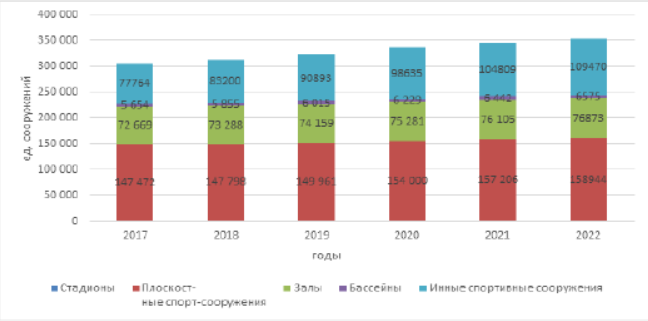

---
output:
  pdf_document:
    latex_engine: xelatex
mainfont: Arial
---
# Разведочный анализ данных (EDA)

Разведочный анализ это первый, "ознакомительный" этап работы с данными. Задача - посмотреть, что вообще есть в данных, найти скрытые закономерности, странности и противоречия, проверить первые предположения и сформулировать гипотезы. Для этого используются визуализация, описательная статистика, группировки, рейтинги и другие простые инструменты - до того, как строить прогнозные или причинно-следственные модели.

## Описание исследования

- **Название:** Проведение разведочного анализа данных о состоянии физической культуры в России
- **Авторы:** Параскевопуло О.Р., Гельмиярова В.Н., Козлова О.Ю., Кузнецова Е.Ю., Немировская-Дутчак О.Э.
- **Год:** 2024
- **DOI:** [10.55186/2413046X_2023_9_1_3](https://doi.org/10.55186/2413046X_2023_9_1_3)
- **Ссылка:** [CyberLeninka](https://cyberleninka.ru/article/n/provedenie-razvedochnogo-analiza-dannyh-o-sostoyanii-fizicheskoy-kultury-v-rossii)

## Обоснование выбора

В статье прямо заявлено использование методов, характерных для EDA:

- классификация и систематизация данных;
- нормировка статистических показателей;
- рейтингование регионов;
- табличное и графическое представление данных.

Авторы отмечают:

> «Статистические исследования позволяют получить объективную информацию о том, как часто и каким образом люди занимаются физической активностью, какие виды спорта являются наиболее популярными, как изменяется уровень подготовленности населения».

Исследователи не строят сразу строгую причинно-следственную модель - вместо этого проводится первичное "углубление" в данные: анализируются разнородные показатели по регионам, выявляются противоречия между подходами, фиксируются тренды. Что отлично ложится на цель разведочного анализа данных - сформулировать гипотезы для дальнейшего моделирования

# Одна из таблиц статьи

------------------------------------------------------------------------

# Механистический анализ данных

**Механистический анализ** нужен не для того, чтобы просто найти статистическую корреляцию. Его задача - понять и математически описать внутренний механизм процесса, который порождает данные: физический, биохимический, экономический и т.д. У параметров таких моделей есть конкретный предметный смысл.

## Описание исследования

- **Название:** Развитие методов прогнозирования структуры потока на вертикальных участках нефтяных скважин
- **Авторы:** Михайлов В.Г., Волков М.Г.
- **Год:** 2024
- **DOI:** [10.24412/2076-6785-2024-6-100-105](https://doi.org/10.24412/2076-6785-2024-6-100-105)
- **Ссылка:** [CyberLeninka](https://cyberleninka.ru/article/n/razvitie-metodov-prognozirovaniya-struktury-potoka-na-vertikalnyh-uchastkah-neftyanyh-skvazhin)

## Обоснование выбора

Авторы противопоставляют свои методы чисто эмпирическим подходам, отмечая, что последние «не обладают требуемой точностью» вне узкого диапазона условий. В работе используется механистическое моделирование: новые критерии прогнозирования структуры газожидкостного потока разработаны на основе решения фундаментального уравнения сохранения количества движения

Упрощённая форма уравнения баланса импульса для вертикального участка скважины имеет вид:

$$
\frac{dP}{dz} = -\rho_m g \sin\theta - \frac{f_m \rho_m v_m^2}{2D} - \frac{d}{dz}\left(\alpha \rho_g v_g^2 + (1-\alpha)\rho_l v_l^2\right)
$$

где:

- $P$ — давление,
- $\rho_m$ — плотность смеси,
- $g$ — ускорение свободного падения,
- $f_m$ — коэффициент трения смеси,
- $v_m$ — скорость смеси,
- $D$ — диаметр трубы,
- $\alpha$ — объёмное содержание газовой фазы.

Этапы механистического анализа в исследовании:

1.  Формулировка физической модели процесса (двухфазный поток);
2.  Запись уравнений сохранения (массы, импульса);
3.  Анализ условий структурного перехода (пробковый - пузырьковый режим);
4.  Получение критериев перехода без эмпирических коэффициентов;
5.  Верификация модели на промысловых данных.

------------------------------------------------------------------------

# Сравнительный анализ подходов

| Критерий | Разведочный анализ (EDA) | Механистический анализ |
|------------------------|------------------------|------------------------|
| **Основная цель** | Выявление закономерностей, формулировка гипотез | Понимание внутреннего механизма процесса |
| **Тип модели** | Описательная, визуальная | Физико-математическая |
| **Интерпретируемость** | Средняя | Высокая (параметры имеют физический смысл) |
| **Применимость** | Широкая, без знания физики процесса | Требует знания предметной области |
| **Пример из работы** | Рейтингование регионов по спорту | Прогноз режима течения в скважине |

------------------------------------------------------------------------

# Заключение

В ходе работы были рассмотрены два вида анализа данных:

**Разведочный анализ** - первичное изучение данных; визуализация и описательная статистика; формулирование гипотез.

**Механистический анализ** - построение физически обоснованных моделей; использование фундаментальных законов; объяснение причинно-следственных связей.

Оба подхода взаимодополняют друг друга в реальном исследовании: EDA помогает понять структуру данных и сформулировать гипотезы, а механистический анализ - раскрыть механизм изучаемого явления

## Список использованных источников

1.  Параскевопуло О.Р. и др. Проведение разведочного анализа данных о состоянии физической культуры в России // Наука и спорт: современное состояние. 2024. DOI: [10.55186/2413046X_2023_9_1_3](https://doi.org/10.55186/2413046X_2023_9_1_3)
2.  Михайлов В.Г., Волков М.Г. Развитие методов прогнозирования структуры потока на вертикальных участках нефтяных скважин // Инженерно-строительный журнал. 2024. DOI: [10.24412/2076-6785-2024-6-100-105](https://doi.org/10.24412/2076-6785-2024-6-100-105)
3.  Репозиторий проекта на GitHub: <https://github.com/MiiroSun/RStudio>
